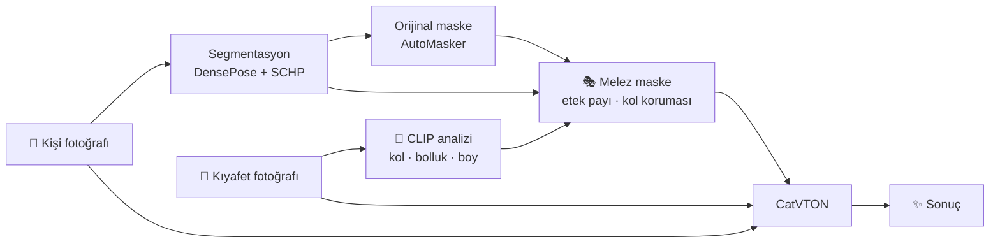

<div align="center">

# 👕✨ Sanal Deneme Kabini

**Bir kişi fotoğrafı + bir kıyafet fotoğrafı → kişinin o kıyafeti giymiş hâli**


[Neden maske?](#-neden-maske) •
[Analiz](#-1-orijinal-maskenin-analizi) •
[Melez yaklaşım](#-3-melez-yaklaşım) •
[Kıyafet analizi](#-4-kıyafet-analizi) •
[Kurulum](#-kurulum) •
[Kullanım](#-kullanım)

</div>

---

## 🎯 Ne yapıyor?

Görüntüyü üreten model hazır eğitilmiş [CatVTON](https://github.com/Zheng-Chong/CatVTON). Bu projede model eğitilmedi. Projenin katkısı modelin **etrafındaki** kısım:

| | Katkı |
|:-:|---|
| 🔍 | CatVTON'un maske üreticisinin kod düzeyinde analizi |
| 🎭 | Kıyafete göre maske düzeltmesi (etek payı, çıplak kol koruması) |
| 🧠 | Kıyafet fotoğrafından kol boyu, bolluk ve boyun otomatik tahmini |
| ⚖️ | Hepsinin orijinal yöntemle aynı koşullarda karşılaştırılması, işe yaramayan denemeler dahil |



---

## 🤔 Neden maske?

Sanal deneme modelleri "inpainting" ile çalışır: fotoğrafın bir bölgesi maskelenir, model o bölgeyi yeni kıyafetle doldurur. Maske iki şeyi belirler: neyin silineceğini ve modelin nereye çizebileceğini. İlk denemelerimde adım sayısını 20'den 100'e çıkarmak sonucu değiştirmedi, elle çizdiğim maske ise değiştirdi. Bu yüzden modele değil maskeye odaklandım.

## 🔍 1. Orijinal maskenin analizi

CatVTON'un `AutoMasker` sınıfı üç segmentasyon haritası kullanıyor: DensePose (vücut bölgeleri) ve iki SCHP ayrıştırıcısı (LIP ve ATR etiketleri). `model/cloth_masker.py` dosyasında şunları buldum:

| Satır | Ne yapıyor | Sonucu |
|---|---|---|
| 215 | Yüz korumasında sadece LIP haritasına bakıyor | LIP kulağı ve boynu yüz saymıyor, ikisi de korunmuyor |
| 232, 240 | Maskeyi "arka plan olmayan ve korunmayan her şey" olarak kuruyor | Bir ayrıştırıcının yanlış etiketlediği piksel maskeye sızıyor |
| 242, 244 | Dışbükey zarf çekip yaklaşık 41 piksel bulanıklaştırıyor | Maske kutu gibi geniş oluyor |

Sonuç: maskede kulağın üstünde kopuk bir leke oluşuyor, boyun çeneye kadar maskeleniyor ve maske kolların dışındaki arka planı da kaplıyor. İlk bakışta bunlar kusur gibi görünüyor. Aşağıda anlattığım gibi, genişliğin bir işlevi olduğu sonradan ortaya çıktı.

## 💥 2. İlk yaklaşım: maskeyi sıfırdan kurmak (başarısız)

İlk fikrim orijinal maskeyi atıp yerine daha "akıllı" bir maske koymaktı:

```
maske = eski kıyafetin alanı ∪ yeni kıyafetin kaplayacağı alan − korunan bölgeler
```

Kol boyu, bolluk, etek payı ve yaka payı kurallarını tek bir stüdyo fotoğrafında deneyerek ekledim ve o fotoğrafta sonuç iyiydi. Sonra farklı kişilerde denedim ve üç ayrı hata çıktı:

| Deneme | Hata |
|---|---|
| Uzun kollu gömlekten kısa kollu formaya | Bileklerde eski gömleğin siyah manşetleri kaldı |
| Boğazlı kazaktan hırkaya | Çenenin altında kazağın boğazı kaldı |
| Gömlekten kolsuz yeleğe | Model kollara koyu gri kumaş çizdi (üç farklı seed ile üçünde de) |

Sebepleri:

- **Manşetler:** DensePose'un "el" bölgesi manşeti de kapsıyor. Eli koşulsuz koruyunca eski kumaş da korundu.
- **Boğazlı kazak:** İki ayrıştırıcı da boğaz kısmını kıyafet olarak etiketlemedi (biri "arka plan", diğeri "yüz" dedi). "Eski kıyafeti sil" kuralı orayı göremedi.
- **Gri kollar:** Maske eski kolun şeklini birebir takip ediyordu. Model maskenin şeklini kıyafet silueti için ipucu olarak kullanıyor; kol biçimli maske "buraya kol çiz" demek oldu.

> [!IMPORTANT]
> **Çıkardığım ders:** İki maske iki farklı felsefeyle çalışıyor. Orijinal "emin olmadığın her yeri maskele" diyor, bu yüzden kaba ama segmentasyon hatalarına dayanıklı. Benimki "sadece gerekeni maskele" diyordu, bu yüzden hassas ama segmentasyon her yanıldığında eski kıyafetin bir parçası yerinde kalıyordu. Tek bir kolay fotoğrafa bakarak kural yazmak da bu kırılganlığı gizledi.

Bu yaklaşımın kodu repoda duruyor (`build_upper_mask`, `--yontem sifirdan`).

## 🎭 3. Melez yaklaşım

Orijinal maskeyi temel alıp üstüne yalnızca deneyde işe yaradığını gördüğüm düzeltmeleri ekledim (`build_hybrid_mask`):

| Düzeltme | Ne zaman devreye girer |
|---|---|
| **Etek payı** | Yeni kıyafet eskisinden uzunsa maske aşağı uzar. Kadrajda alt giyimden az yer kaldıysa pay kısılır. |
| **Çıplak kol koruması** | Yeni kıyafet kolu örtmeyecekse ve kol zaten çıplaksa kişinin kendi kolu korunur. Kol kumaşla kaplıysa dokunulmaz. |
| **Leke temizliği** | Ana maskeden kopuk küçük parçalar silinir. |

Hiçbir düzeltme uygun değilse maske orijinalle aynı kalır. Yani en kötü ihtimalle orijinalle aynı sonuç alınır.

### 📊 Dört kişide karşılaştırma

Aynı kişi, aynı kıyafet, aynı seed (42), 20 adım. Değişen tek şey maske.

| Kişi → kıyafet | Uygulanan düzeltme | Sonuç |
|---|---|---|
| Kolsuz atletli adam → kısa kollu bol forma | Etek payı, çıplak kol koruması | ✅ **Melez daha iyi:** forma pantolon düğmesini kapatıyor, ön kollar kişinin kendi kolları |
| Boğazlı kazaklı, uzun saçlı kadın → hırka | Etek payı | ✅ **Melez daha iyi:** etek bandı ve dördüncü düğme çıkıyor |
| Uzun kollu gömlekli adam → kısa kollu forma | Yok (kol kaplı, kadraj dar) | ➖ Orijinalle aynı |
| Gömlekli, elleri belinde adam → kolsuz yelek | Etek payı | ➖ Orijinalle aynı seviyede |

> [!NOTE]
> Dört örnek küçük bir set. "Melez her zaman daha iyi" diyemem; "bu dört örneğin ikisinde gözle görülür iyileşme var, hiçbirinde kötüleşme yok" diyebilirim.

## 🧠 4. Kıyafet analizi

Maske düzeltmelerinin ayarlarını (kol boyu, bolluk, etek payı) elle vermek hataya açık: bir denemede oversize formaya "normal bolluk, etek payı yok" dedim ve sonuç kötü çıktı. Bu yüzden ayarları kıyafet fotoğrafından çıkaran iki yöntem denedim.

| Yöntem | Nasıl çalışır | Kol boyu doğruluğu (17 fotoğraf) |
|---|---|---|
| 📐 Kural tabanlı (`garment.py`) | GrabCut ile siluet, gövde ve kol geometrisi | 14 / 17 |
| 🏆 CLIP sıfır-örnek (`garment_clip.py`) | Fotoğrafı "uzun kollu üst", "kısa kollu üst", "kolsuz üst" cümleleriyle karşılaştırır | **17 / 17** |

Kural tabanlı yöntemin üç hatası iki sınırı gösteriyor: açık zeminde beyaz kıyafetin silueti çıkarılamıyor, kolları gövdeye yapışık duran kıyafet dış hattan kolsuz görünüyor. CLIP üçünü de bildi, bu yüzden varsayılan yöntem o. CLIP aynı şekilde bolluğu ve boyu da tahmin ediyor; bunların etiketli doğrulamasını yapmadım.

Test seti 17 fotoğraf (6 kısa kol, 7 uzun kol, 4 kolsuz), alışveriş sitelerinden toplandı. Küçük bir set, sonuçlar genellenmeden önce büyütülmeli.

## 🚧 Bilinen sınırlar

- **Uzun koldan kolsuza geçiş:** Model kolu yeniden çizmek zorunda. Üç seed'de üç farklı sonuç verdi (kısa kol, hırka kolu, başka birinin kolları). Maske bunu çözmüyor.
- **Yazı ve rakamlar:** Kıyafetteki yazılar bozuk çıkabiliyor. Bu modelin sınırı, orijinal maskede de aynı.
- **Tek seed:** Karşılaştırmalar seed 42 ile yapıldı. Bulguların bir kısmı şans payı içerebilir.
- **Sadece üst giyim:** Alt giyim, elbise ve katmanlı kıyafet (iç/dış) için düzeltme yok.
- **Segmentasyon:** Boğazlı kazak gibi durumlarda ayrıştırıcılar yanılıyor. Melez yaklaşım bu hatalara dayanıklı, ama çıplak kol koruması yine haritalara güveniyor.

## 🔧 Kurulum

Gerekenler: Windows, Python 3.9, NVIDIA ekran kartı (RTX 4050 6 GB ile test edildi), çalışan bir CatVTON kurulumu.

CatVTON bu repoya kopyalanmaz. Önce [kendi reposundaki](https://github.com/Zheng-Chong/CatVTON) talimatla kur, sonra:

```powershell
git clone https://github.com/burakkmert/sanal-deneme-kabini.git
cd sanal-deneme-kabini
```

`ortam.ps1` dosyasındaki `$CatVTON` yolunu kendi kurulumuna göre değiştir. Her yeni terminalde bir kez çalıştır:

```powershell
.\ortam.ps1
```

Bu script CatVTON'un sanal ortamını açar ve yerini `CATVTON_DIR` değişkenine yazar. CLIP modeli (yaklaşık 600 MB) ilk kullanımda Hugging Face'ten iner.

## 🚀 Kullanım

```powershell
python scripts\03_uretim_karsilastir.py --kisi KISI.jpg --kiyafet KIYAFET.jpg
```

Kol boyu, bolluk ve etek payı kıyafet fotoğrafından tahmin edilir; istersen `--kol`, `--bolluk`, `--etek` ile elle verebilirsin. Çıktı `outputs/03_uretim/NNN_.../` klasörüne yazılır: iki maske, iki sonuç, yan yana karşılaştırma ve `ayarlar.json`.

768×1024 çözünürlükte, 20 adımda tek üretim yaklaşık 26 saniye ve 4,9 GB VRAM.

| Script | Ne yapar |
|---|---|
| `01_maske_incele.py` | AutoMasker'ın maskesini ve üç segmentasyon haritasını kaydeder |
| `02_maske_karsilastir.py` | Görüntü üretmeden maskeleri yan yana gösterir |
| `03_uretim_karsilastir.py` | Orijinal ve melez maskeyle aynı seed'de iki üretim yapar |
| `04_kiyafet_olc.py` | Kıyafet fotoğraflarının siluetini çıkarır ve ölçer |
| `05_kol_yontem_karsilastir.py` | Kural tabanlı yöntem ile CLIP'i aynı klasörde karşılaştırır |

## 📁 Yapı

```
kabin/
  labels.py        segmentasyon etiketleri
  masking.py       melez maske (build_hybrid_mask) ve ilk yaklaşım (build_upper_mask)
  catvton.py       CatVTON köprüsü: model, maskeleyici, üretim
  garment.py       kural tabanlı kıyafet ölçümü
  garment_clip.py  CLIP ile kıyafet analizi
  kayit.py         numaralı çıktı klasörleri
scripts/           yukarıdaki beş script
```

## 🧭 Yol haritası

- [ ] Daha büyük test seti ve birden fazla seed ile karşılaştırma
- [ ] VITON-HD test setinde sayısal değerlendirme (SSIM, LPIPS)
- [ ] Alt giyim, elbise ve katmanlı kıyafet
- [ ] Gradio arayüzü
- [ ] Birim testleri

## 📜 Lisans ve kaynaklar

- **CatVTON** (Chong ve ark.) kodu ve ağırlıkları [CC BY-NC-SA 4.0](https://creativecommons.org/licenses/by-nc-sa/4.0/) lisanslıdır: ticari kullanım yasak, kaynak gösterilmeli. Bu repo aynı lisansla paylaşılır ve yalnızca eğitim ve portföy amaçlıdır.
- **CLIP:** `openai/clip-vit-base-patch32`.
- **Test görselleri:** Denemelerde CatVTON'un örnek görselleri ile stok ve alışveriş sitelerinden alınan fotoğraflar kullanıldı. Lisansları ayrı olduğu için bu repoda yer almıyorlar; sonuçları kendi fotoğraflarınla üretebilirsin.

---

<div align="center">

⭐ Bu repo bir portföy ve öğrenme projesidir. Fikir ve eleştiriye açığım.

</div>